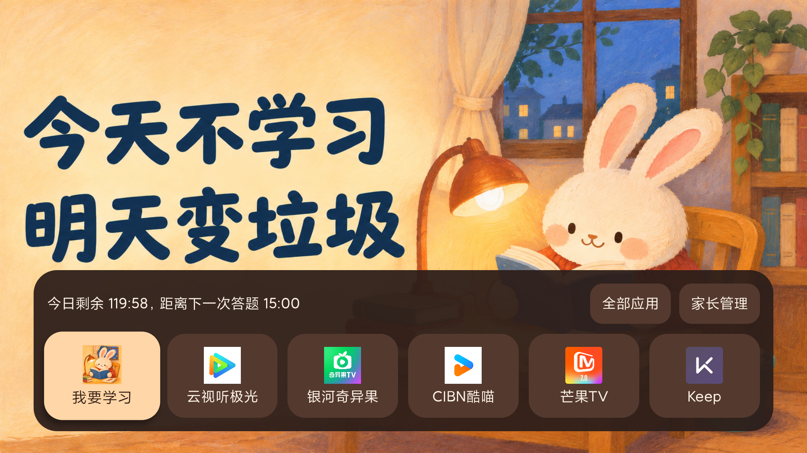
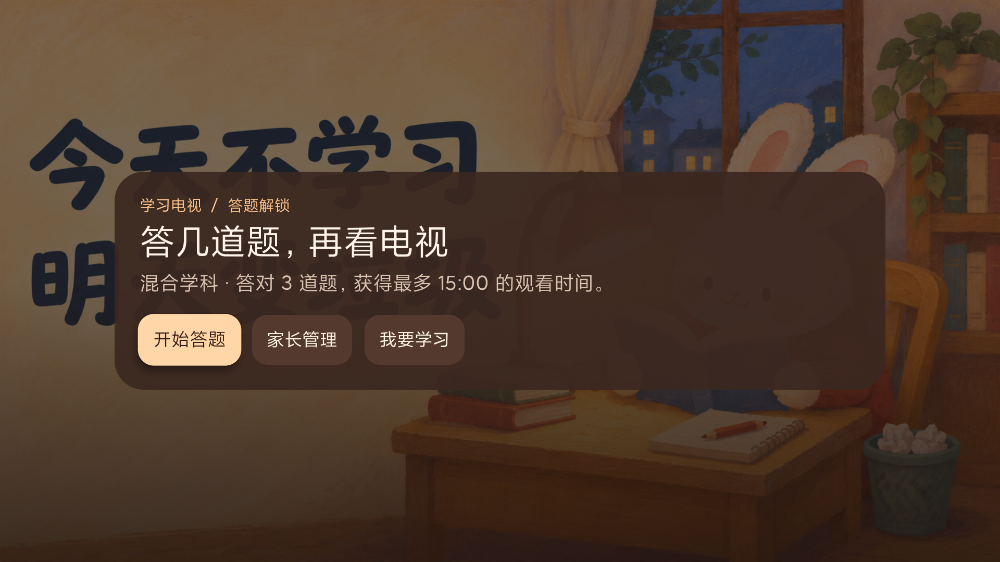
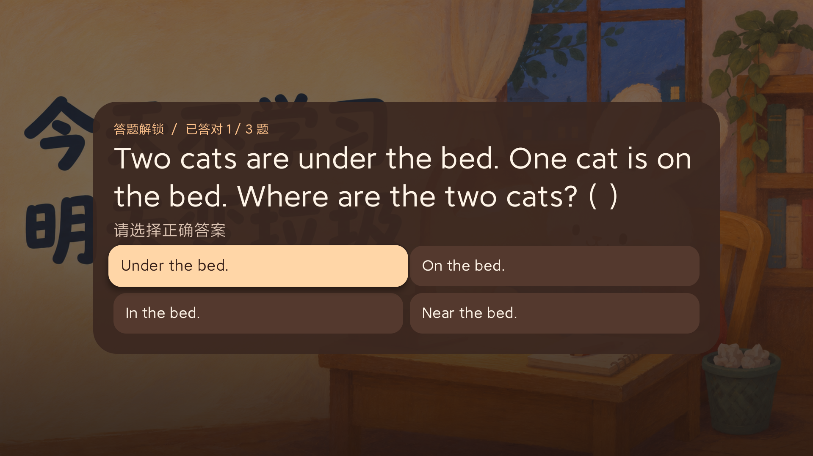
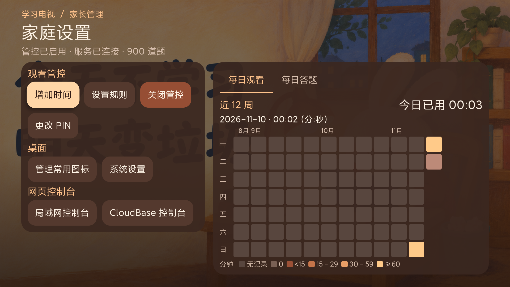

# 学习电视 · StudyTV

为 Redmi X65（L65R8-X）准备的本地 Android TV 桌面。桌面提供常用图标、应用列表和自定义背景。开启观看管控后，孩子用遥控器答题获取时间，家长用 6 位 PIN 管理。APK 支持 Android 6.0（API 23）及以上。

电视端默认使用暖暮背景，应用坞和控件以深棕、陶土色和杏色区分层次。遥控器聚焦时控件会切换为浅杏色并轻微放大，按下时回落。应用坞布局参考 [Aerial TV](https://github.com/pengchujin/aerial-tv)。

## 界面截图

**电视桌面**



**观看管控**



**答题解锁**



**家长管理**



## 在电视上安装

1. 让 Mac 和电视连接同一局域网。在电视「设置 → 关于」对产品型号连续按约 7 次确认键，然后在「设置 → 账号与安全」允许 ADB 调试。不同固件的菜单位置可能有差异。查看电视的 IP。
2. 在项目目录执行以下命令，把 IP 换成电视显示的地址。若电视弹出 ADB 授权，请用遥控器确认。探测脚本会显示系统版本、原始桌面和电源状态等信息。记录原始桌面的组件名，供恢复时使用。

   ```sh
   TV=192.168.1.100:5555
   adb connect "$TV"
   adb devices -l
   ./scripts/probe-tv.sh "$TV"
   adb -s "$TV" install -r app/build/outputs/apk/debug/app-debug.apk
   adb -s "$TV" shell am start -n tv.study.guard/.HomeActivity
   ```

3. 打开「家长管理」，设置并确认 6 位 PIN。可在「管理常用图标」固定、移除或排序应用，也可固定系统设置入口。电视的信号源或直播入口如果以独立应用形式对桌面开放，也会出现在应用列表。
4. 在电视的系统设置中将默认桌面设为「学习电视」，按实体遥控器的 Home 键确认。若固件没有这个菜单，可以在记录原桌面组件后尝试以下命令，再按 Home 键复查。如果固件继续打开小米桌面，可以从应用列表手动启动「学习电视」。

   ```sh
   adb -s "$TV" shell cmd package set-home-activity tv.study.guard/.HomeActivity
   adb -s "$TV" shell cmd package resolve-activity --brief -a android.intent.action.MAIN -c android.intent.category.HOME
   ```

5. 在电视的系统无障碍设置中打开「学习电视 · 观看管控」。返回家长管理，确认显示「服务已连接」，再按「开启管控」。先用短时长试一次答题、到时覆盖、Home 和待机唤醒，再设回家庭日常规则。

要恢复，先在「家长管理」关闭管控，在系统的默认桌面设置中选回原桌面。也可使用 `adb -s "$TV" shell cmd package set-home-activity '原桌面包名/Activity名'`。确认 Home 恢复后，可按需执行 `adb -s "$TV" uninstall tv.study.guard`。卸载会清除本应用的配置、题库和背景。

## Redmi X65 的 6129 固件

Redmi X65 实机报告为 MiTV-MFTP0（alita）、Android 9、固件增量号 6129。在这版固件上，标准包的桌面切换命令虽返回成功，系统仍选择小米桌面。适配版通过固件接受的本机兼容包名 `com.ts.launcher` 注册桌面，并将桌面与管控服务放在同一个 `:home` 进程。该包名可能和其他桌面应用冲突，适配版仅供这台电视使用。安装前先确认电视没有该包名的其他应用。

```sh
./gradlew --project-cache-dir .gradle/xiaomi-6129 -Pxiaomi6129=true :app:assembleDebug
adb -s "$TV" shell pm list packages -u com.ts.launcher
```

只有查询结果为空时，再执行首次安装和桌面切换。确认前台窗口和实体遥控器 Home 键都能进入「学习电视」。

```sh
adb -s "$TV" install build/xiaomi-6129/app/outputs/apk/debug/app-debug.apk
adb -s "$TV" shell am start -n com.ts.launcher/tv.study.guard.HomeActivity
adb -s "$TV" shell cmd package set-home-activity --user 0 com.ts.launcher/tv.study.guard.HomeActivity
adb -s "$TV" shell cmd package resolve-activity --brief -a android.intent.action.MAIN -c android.intent.category.HOME
```

此固件没有标准的无障碍设置页。用以下命令把「学习电视 · 观看管控」追加到现有服务列表。进入家长管理，确认「服务已连接」，再设置规则并开启管控。

```sh
SERVICE=com.ts.launcher/tv.study.guard.GuardService
EXISTING=$(adb -s "$TV" shell settings --user 0 get secure enabled_accessibility_services | tr -d '\r')
[ "$EXISTING" = null ] && EXISTING=''
case ":$EXISTING:" in
  *":$SERVICE:"*) ;;
  *) adb -s "$TV" shell settings --user 0 put secure enabled_accessibility_services "${EXISTING:+$EXISTING:}$SERVICE" ;;
esac
adb -s "$TV" shell settings --user 0 put secure accessibility_enabled 1
adb -s "$TV" shell dumpsys accessibility | grep -F 'com.ts.launcher'
```

这台 6129 固件在电源键短按模式 `0` 下会强停「学习电视」，系统随后移除它的无障碍服务。可以将短按切换为 STR 待机（模式 `2`）。兼容版收到固件的 STR 唤醒通知后会检查答题规则，并在亮屏后恢复默认桌面。STR 唤醒后，电视可能关闭网络 ADB，需要在电视上重新打开调试才能查看日志。若服务已被移除，先重新打开应用，再按上面的命令追加服务。

```sh
adb -s "$TV" shell settings --user 0 put system mitv.short.power.action 2
```

要恢复原桌面，关闭观看管控，再执行以下命令。恢复后可卸载本机兼容版，卸载会同时清除它的配置和本地文件。

```sh
adb -s "$TV" shell cmd package set-home-activity --user 0 com.mitv.tvhome/.MainActivityUserMode
adb -s "$TV" shell settings --user 0 put system mitv.short.power.action 0
adb -s "$TV" shell input keyevent KEYCODE_HOME
```

兼容方式参考 [CleanYourTV 同型号同固件的待机记录](https://github.com/Gathin23/cleanyourtv/issues/1434)。

## 默认规则

| 项目 | 默认值 |
| --- | --- |
| 冷启动后或当天首次答题 | 5 道题，最多观看 30 分钟 |
| 续看答题 | 3 道题，最多观看 15 分钟 |
| 每日观看上限 | 60 分钟 |
| 连续观看上限和休息时长 | 30 分钟，休息 5 分钟 |
| 待机唤醒 | 重新答题，可改为保留剩余时间 |
| 答错 | 直接换题，本轮需答对的总题数加一。加量后达到 10 题即休息 10 分钟，之后从本轮原定题量重新开始 |
| 家长额外授权 | 电视和网页均可增加 1–60 分钟，默认 15 分钟。保留正在进行的强制休息 |

「家长管理 → 设置规则」可以改题数、奖励时长、每日上限、连续时长、休息时长和待机规则。短按 + / − 调整 1，长按调整 5。亮屏时，其他 Android 应用在前台才累计时间，留在「学习电视」桌面、进入小米屏保或待机会暂停。离开观看满一个休息时长会清空连续观看计数。每日额度按电视本地日期更新，重启会保留当日已用时长，并要求重新答题。应用进程重启时也会收回本轮剩余时间。

## 从手机或电脑管理

电视默认显示手机验证二维码。用同一局域网内的手机扫码，或在手机浏览器输入电视显示的地址，再输入已有的家长 PIN。从电视「家长管理」发起扫码时，验证通过后手机会直接进入网页后台，电视会打开「家庭设置」。也可选「切换到电视键盘」用遥控器验证，输入第 6 位数字即提交。家长管理遇到休眠或屏保后，恢复时需重新验证 PIN。扫码入口有效期为 2 分钟，过期后可选择「重新开启扫码」。

设置家长 PIN 后，局域网控制台会在电视开机时自动启动。「家长管理 → 局域网控制台」显示当前访问地址，例如 `http://192.168.1.100:8787`。用同一局域网内的手机或电脑打开这个地址，输入 6 位家长 PIN 即可管理。网页管理固定使用 `8787` 端口。

网页可以查看观看用量、启停管控、增加 15 分钟、保存观看规则、固定和调整常用应用顺序，以及上传题库、图片和视频。设置直接保存在电视上。首次开启管控仍需在电视上启用无障碍服务。

网页管理使用家庭局域网内的 HTTP。电视切换到其他页面或应用时，控制台继续提供服务。待机断网后，电视重新联网时会恢复监听。若电视的 IP 地址变化，请使用电视显示的新地址。浏览器登录有效期为 15 分钟，到期后可以直接在网页上重新输入 PIN。电视键盘、手机扫码和网页登录共用家长 PIN 的输错次数。连续输错 3 次后，电视进入 5 分钟强制休息，倒计时结束后才能再次验证。验证成功会清零输错次数。

### 使用腾讯云 CloudBase 从外网管理

开启 CloudBase 控制台后，电视开机联网时会主动订阅 CloudBase **传统模式**文档型数据库的变更。家长在外网页面发出操作后，云函数写入一条短期指令，电视收到通知后领取并执行。待机时电视会暂停订阅。首次配对和订阅凭证失效后的恢复会调用云函数，正常空闲期间仅维持数据库订阅，并向 CloudBase 身份认证续期。云函数按调用次数和执行资源计量，数据库、认证和网关用量按 CloudBase 环境套餐计算。 [文档型数据库实时推送](https://docs.cloudbase.net/database/realtime) · [资源点价格文档](https://cloud.tencent.com/document/product/876/127357)

外网页面支持查看观看时长看板和历史、每日答题统计、启停管控、加时 1–60 分钟、修改规则、管理常用应用、切换出题范围、删除学科题库，以及切换电视上已有的背景。上传 JSON 题库、图片和视频请使用局域网管理。一套部署连接一台电视，电视须在 10 秒内领取指令并回执。网页只在等待本次操作时查询回执。

1. 在传统模式的 CloudBase 环境中启用用户名密码登录，创建一个专用的普通用户用于电视订阅，记录其用户名、密码和 UID。使用默认文档型数据库实例新建集合 `studytv_remote`，并手动添加以下两条文档。 [CloudBase 身份认证](https://docs.cloudbase.net/authentication-v2/auth/introduce)

   ```json
   {"_id":"tv","revision":"initial","phase":"idle"}
   ```

   ```json
   {"_id":"session","revision":"initial"}
   ```

   将该集合的权限设为「自定义安全规则」。将 `TV_USER_UID` 替换成专用用户的实际 UID。 [文档型数据库安全规则](https://docs.cloudbase.net/database/security-rules)

   ```json
   {"read":"auth.uid == 'TV_USER_UID' && doc._id == 'tv' && doc.phase == 'queued'","write":false}
   ```

2. 执行 `bash scripts/package-cloudbase.sh` 得到 `build/cloudbase/study-tv-cloudbase-function.zip`。在控制台新建 **HTTP 云函数**，选择 Node.js 22 运行时，通过「本地上传」上传 ZIP。函数监听平台要求的 `9000` 端口，执行超时可设为 15 秒。使用按请求计费，预置并发保持为零。 [HTTP 云函数部署](https://docs.cloudbase.net/cloud-function/quickstart/httpfunc/nodejs) · [支持的运行时](https://docs.cloudbase.net/cloud-function/runtime-support)
3. 配置函数运行时环境变量。两个应用令牌须不同，可以分别执行一次 `openssl rand -hex 32` 生成。自备令牌须使用 32–128 位字母、数字、下划线或短横线。

   | 环境变量 | 用途 |
   | --- | --- |
   | `STUDYTV_PARENT_TOKEN` | 家长浏览器登录时输入，会话有效期 30 分钟 |
   | `STUDYTV_DEVICE_TOKEN` | 在电视上配置，用于向云函数领取操作和提交回执 |
   | `STUDYTV_WATCH_USER` | 步骤 1 创建的普通用户的用户名 |
   | `STUDYTV_WATCH_PASSWORD` | 该用户的密码，仅配置在云函数中 |
   | `CLOUDBASE_ENV_ID` | CloudBase 环境 ID |
   | `CLOUDBASE_REGION` | 环境地域代码，例如 `ap-shanghai` |
   | `CLOUDBASE_APIKEY` | CloudBase 服务端 API Key，仅配置在云函数中，用于写入中继集合 |
   | `STUDYTV_PUBLIC_ORIGIN` | 外网控制台的 HTTPS 来源，仅填协议和域名，如 `https://tv.example.com` |

4. 在 CloudBase HTTP 网关将 HTTPS 域名的根路径 `/` 透传到该函数。关闭这条路由的网关鉴权开关，由应用校验家长和电视令牌。正式使用时绑定 HTTPS 自定义域名。 [HTTP 网关绑定云函数](https://docs.cloudbase.net/service/access-cloud-function) · [默认域名限制](https://docs.cloudbase.net/service/alias)
5. 安装新版 APK，在电视上验证家长 PIN，打开「家长管理 → CloudBase 控制台」。输入函数的 HTTPS 根地址和电视连接令牌，保存连接设置，再开启 CloudBase 控制台。等电视显示「已建立 CloudBase 实时订阅」，用手机移动数据打开同一个地址，输入家长令牌并刷新状态。

如果已部署过支持外网上传的版本，重新部署新版云函数以停用旧上传接口。新版使用原有的 `tv` 和 `session` 文档。

电视和局域网网页都可以开关 CloudBase 控制台。开关状态在电视重启后保留。关闭会断开电视的 CloudBase 连接，重新开启会沿用已保存的地址和电视令牌。首次配置默认关闭，升级前已经配置并连接的电视继续使用原来的开启状态。

修改家长令牌会使旧登录会话失效。更换电视令牌后需在电视上重新保存。观看记录与管控设置以电视为准，云端集合仅保留一个加密的操作或回执，以及家长会话的校验摘要。读取回执后会清空操作记录，未读取的过期密文会在下次提交时覆盖。

## 自定义题库和背景

在「家长管理 → 局域网控制台」打开局域网页面，上传 UTF-8 JSON 题目数组。每道题按自己的 `subject` 归入对应学科，同一文件可包含多个学科。缺少 `subject` 的题目归入网页上填写的备用学科，留空时归入「默认学科」。

```json
[
  {"subject": "语文", "question": "“睡觉”的“觉”读（ ）", "options": ["zhī", "jué", "zhǐ", "jiào"], "answer": 3, "explanation": "“觉”表示睡眠时读 jiào，比如“睡觉”和“午觉”。"},
  {"subject": "数学", "question": "7 + 8 等于多少？", "options": ["14", "15"], "answer": 1, "explanation": "把 8 拆成 3 和 5，先算 7 + 3 = 10，再算 10 + 5 = 15。"}
]
```

最多导入 9 个学科，每科 1–999 道题，文件上限 8 MiB。同名题库在文件校验通过并确认后替换。旧版自定义题库显示为「默认学科」。每题包含 `question`、`options`、`answer`。每题提供 2–6 个不同选项，`answer` 从 0 起算。也可从 [数组格式的示例题库](app/src/main/assets/questions.json) 开始修改。

`explanation` 填写 1–260 字的解析，在「我要学习」提交答案后显示。缺少该字段的题目仍可练习，并显示「这道题暂无解析」。如需恢复旧版导入时未保存的解析，请重新导入带 `explanation` 的 JSON。

电视「我要学习 → 错题集 · 复习错题」可复习答题解锁和自主练习中答错的题。错题从本版本开始自动收录，同一学科、题干、选项和正确答案相同的题只保留一份，不受选项乱序影响。错题保存在电视上，重启、替换或删除原学科题库后仍可复习，并保留原题的答案和解析。每轮复习随机出题，每题一次；答对后仍保留在错题集中，答题统计计入原学科。错题集不占用导入学科名额。

电视「家长管理 → 出题科目」和网页「题库与背景 → 答题题库」支持复选多个科目，并分别设置周一到周日的出题安排。先设置「默认科目」，再为需要单独安排的星期取消「使用默认科目」并复选科目；未单独设置的星期随默认科目一起更新。切换日期会保留当前修改，按「保存全部设置」后统一生效，重启后保留。按电视本地日期自动切换当天范围，跨天时会清除未完成的答题轮次。旧版单科目设置自动作为默认科目继续使用。

电视端以「默认科目、周一至周日」标签栏切换日期，今天会单独标注。遥控器左右键切换标签，下键进入当天科目，上键可回到当前标签；切换标签会保留未保存的复选结果。日期标签沿用「每日观看 / 每日答题」的高亮文字和下划线，选中时增加与看板相同的咖啡色背景；科目条目使用无边框底色区分状态，每个科目均显示复选框。修改后按遥控器返回键或页面「返回」，会询问「保存并返回」「不保存」「继续编辑」；未修改或已恢复原选择时直接返回。

可以复选已导入学科和内置数学题库；「全部已导入学科」为另一种范围选择，会自动包含后续导入的学科，不与单独勾选的科目叠加，没有导入学科时使用内置题库。多科目按各科剩余题量随机抽题。默认及各星期所选科目的**合计题量**均须覆盖首次和续看答题所需题数；不足时可增加科目或先在「设置规则」中调低题数。导入、替换、删除题库也会检查整个星期的安排；删除的科目会从安排中移除，某组删空时恢复为全部已导入学科。剩余题量不足时拒绝删除或替换，并提示受影响的日期。每道题会打乱选项，答错的题会在本轮排除。可用题目耗尽时由内置题库补充。内置题库共 10 道。

CloudBase 外网页面使用同一套设置；升级电视 APK 后，重新运行 `bash scripts/package-cloudbase.sh` 并部署生成的云函数包以更新外网页面。

电视「家长管理」右侧的统计面板可在「每日观看」和「每日答题」之间切换。选择「每日答题」，或打开网页控制台「答题统计」，可按电视本地日期查看近 30 天各学科的总答题数、正确题数和正确率。每次提交答案计入一道题，内置题库归入「数学」。记录从支持此功能的版本开始累计，保存在电视上。

同一页面也可上传图片或视频并切换背景。图片支持电视能够解码的 JPG、PNG、WebP 等格式，最大 24 MB。视频最大 200 MB，建议用 1080p H.264 MP4，电视端静音循环播放。桌面、应用库、家长管理、PIN 验证和答题管控界面共用所选背景，内容页会压暗背景以便阅读。上传的文件会保存在电视上。

## 管控范围

开启观看管控并确认「服务已连接」后，使用实体遥控器测试 Home 键。单按应返回默认桌面，连按应只返回桌面。如果双击仍能打开任务管理器，需要确认该固件是否把遥控器按键交给了无障碍服务。关闭观看管控可恢复系统原有的快捷键行为。

默认桌面自身没有广告。小米开机广告、其他应用的广告和 HDMI 信号由各自的系统或应用控制。普通 Android 前台应用可用无障碍覆盖。进入答题、休息或今日上限界面时，「学习电视」会暂停视频壁纸，并向系统当前的媒体播放器发送暂停指令。支持系统暂停键的播放器可在解锁后手动续播。固件的系统级窗口、语音和快捷键、投屏、HDMI，以及强行停止或撤销服务权限的行为需要实机验证。应用保留原厂桌面和系统包，支持通过切回原桌面恢复。

## 构建

使用 JDK 17、Android SDK Platform 35 和 Android SDK Build-Tools 35。配置 `ANDROID_HOME` 后运行以下命令。

```sh
./gradlew :app:assembleDebug
```

参考 [小米开启 ADB 的方法](https://www.mi.com/sa-en/support/article/KA-06513/)、[CleanYourTV 的无广告桌面](https://github.com/Gathin23/cleanyourtv) 和 [Android 无障碍覆盖层接口](https://developer.android.com/reference/android/view/WindowManager.LayoutParams#TYPE_ACCESSIBILITY_OVERLAY)。

## 开源许可与素材

本项目代码采用 [MIT License](LICENSE)。第三方依赖及其许可：

| 依赖 | 许可 |
| --- | --- |
| [QR Code generator library](https://www.nayuki.io/page/qr-code-generator-library)（Project Nayuki） | MIT，许可文本见 `app/src/main/assets/licenses/qrcodegen.txt` |
| [OkHttp](https://square.github.io/okhttp/)（Square） | Apache-2.0 |
| Gradle Wrapper | Apache-2.0 |

`app/src/main/res/drawable-nodpi/` 下的背景和部分图标由 AI 图像生成工具（ChatGPT / gpt-image）生成，仓库中的图片已移除内嵌的 C2PA 元数据。README 中引用的 Aerial TV、CleanYourTV 等是布局设计与固件适配的参考资料，本仓库不包含这些项目的源码或资源文件。

CloudBase 部署所需的家长令牌、电视令牌、API Key 和电视订阅账号密码只在云函数环境变量中配置，请勿写入仓库或提交记录；变量清单见上文「使用腾讯云 CloudBase 从外网管理」。
